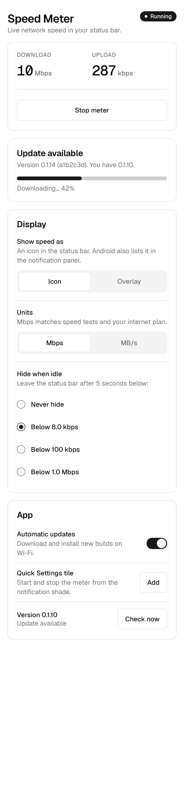
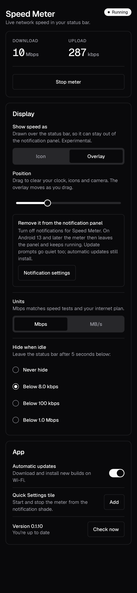
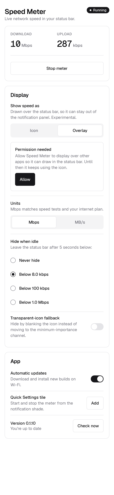

# Speed Meter

An Android app that shows your live download and upload speed **in the status bar**,
so it's always visible next to the clock and battery. It hides itself when the network
is idle, and keeps itself up to date from this repository's builds.

Two display modes:

- **Icon** (default): the speed is the notification's status bar icon. Works on every
  phone, but Android also lists it in the notification panel.
- **Overlay** (experimental): the app draws the speed over the status bar itself, so it
  can stay out of the notification panel entirely.

Kotlin · Jetpack Compose · minSdk 26 (Android 8.0) · targetSdk 35 (Android 15)

| Icon mode, update downloading | Overlay mode (dark) | Overlay needs permission |
|---|---|---|
|  |  |  |

These images are the screenshot-test baselines, so they always match the current code.

---

## Contents

- [Install on your phone](#install-on-your-phone)
- [Using the app](#using-the-app)
- [Settings](#settings)
- [How it works](#how-it-works)
- [Auto-update](#auto-update)
- [Design system](#design-system)
- [Accessibility](#accessibility)
- [Testing on a device](#testing-on-a-device)
- [Development](#development)
- [CI and releases](#ci-and-releases)
- [Project structure](#project-structure)
- [Known limitations and open questions](#known-limitations-and-open-questions)

---

## Install on your phone

1. On your phone, open
   <https://github.com/hystericmoon/internet-speed-meter/releases/download/debug-latest/speed-meter-debug.apk>
   (or the repo's **Releases → Latest debug build**).
2. Open the downloaded file. If asked, allow your browser to install unknown apps.
3. Open **Speed Meter** and tap **Start meter**. Allow notifications when asked; on
   Android 13+ the speed can't appear in the status bar without them.

You only do this once. After that the app updates itself (see [Auto-update](#auto-update)).

---

## Using the app

| Where | What you can do |
|---|---|
| **App** | Start/stop the meter, see live speed, change settings, install updates |
| **Status bar, icon mode** | Two lines: download on top, upload below, e.g. `9.6M` over `287K` |
| **Status bar, overlay mode** | One line drawn over the bar, e.g. `↓9.6M ↑287K`, at the position you choose |
| **Notification** | Icon mode: full speeds (e.g. `↓ 9.6 Mbps   ↑ 287 kbps`) and a **Stop** button. Overlay mode: a static, minimum-priority entry, or nothing at all (see below). Tap it to open the app |
| **Quick Settings tile** | Tap to start/stop. Its subtitle shows live download speed while the shade is open |

The status badge in the app always spells out the state:

| Badge | Meaning |
|---|---|
| **Running** | Measuring; speed shows in the status bar |
| **Idle** | Measuring, but traffic is below your idle threshold: hidden from the status bar (icon) or dimmed (overlay) |
| **Paused** | Screen is off; measuring is suspended to save battery |
| **Stopped** | Meter is off |

**It stays on.** Once started, the meter comes back by itself after a reboot, after
Android kills it, and after an update. Only **Stop** (in the app, notification or tile)
turns it off for good.

### Keeping it out of the notification panel (overlay mode)

On Android an app can only put an icon in the status bar through a notification, and
every notification is also listed in the panel. Overlay mode works around that:

1. **Display → Show speed as → Overlay.** Android asks you to allow *Display over other
   apps* for Speed Meter. Until you do, the app keeps using the icon.
2. **Position:** drag **Horizontal** until the overlay clears your clock, notification
   icons and camera cutout, and **Vertical** to line it up with the clock. The real
   overlay moves as you drag.
3. **Remove the panel entry:** tap **Notification settings** and turn notifications off
   for Speed Meter. On **Android 13 and later** the meter then disappears from the
   notification panel and keeps running. It's only listed under *Active apps* at the
   bottom of Quick Settings, which is where Android lists every running service.
   On Android 12 and older, Android may show its own "running" notice instead.

Turning notifications off also silences update prompts. Updates that can install
silently still do. Anything that needs a tap waits until you open the app.

**Icon mode needs notifications.** The status bar icon *is* the notification, so it
disappears while notifications are off. The app warns about this, whether they were turned off
in the app or in system settings, and offers to switch to Overlay.

**The overlay dims when idle instead of hiding.** When traffic drops below the threshold
it fades to about a third of its opacity, and brightens again when traffic picks up. In
overlay mode the setting reads **Dim when idle**; choose *Never dim* to keep it at full
strength. Why: an overlay that vanishes looks exactly like one that stopped working
(on 0.1.7–0.1.9 "it works for a while, then disappears" was most likely this). Nielsen's
*visibility of system status*: the meter should always show that it's alive.

**Samsung:** on App card → **Background running → Allow** so battery optimisation doesn't
stop the meter. If it still stops, also add Speed Meter to *Settings → Battery →
Background usage limits → Never sleeping apps*.

### Adding the Quick Settings tile

- **Android 13+**: App → **App** card → **Quick Settings tile → Add**. The system asks to confirm.
- **Android 12 and older**: pull down Quick Settings, tap the pencil/edit icon, and drag
  **Speed meter** into your tiles.

---

## Settings

### Display

| Setting | Options | Default | Notes |
|---|---|---|---|
| **Show speed as** | Icon · Overlay | **Icon** | See [display modes](#keeping-it-out-of-the-notification-panel-overlay-mode). Overlay needs *Display over other apps*. |
| **Position: horizontal** | Slider, left → right | 30% from left | Overlay only. Moves the overlay live. |
| **Position: vertical** | Slider, up → down | Centred | Overlay only. Up to half the status bar's height either way, to line up with the clock. |
| **Hide in landscape** | On · Off | **On** | Overlay only. The dependable way to keep it off full-screen video and games, which are almost always landscape. See [Full-screen detection](#full-screen-detection). |
| **Units** | Mbps · MB/s | **Mbps** | Mbps (megabits, decimal) is how ISPs and speed tests quote speed. MB/s (megabytes, binary) is what file managers and downloads show. 1 MB/s ≈ 8.4 Mbps. |
| **Hide when idle** (icon) / **Dim when idle** (overlay) | Never · Below 8 kbps · Below 100 kbps · Below 1 Mbps | **Below 8 kbps** | After **5 seconds** below the threshold (download + upload combined) the icon leaves the status bar, and the overlay dims. Back the moment traffic rises above it. Raise it if background sync keeps the icon flickering on. |

**Why Mbps by default:** people check the meter against their plan ("100 Mbps") and
speed-test results. Showing MB/s would read 8× smaller than they expect. This follows
Nielsen's *match between the system and the real world* heuristic.

**How hiding works:** in icon mode the notification moves to a *minimum-importance*
channel, which Android keeps out of the status bar. On a Samsung A55 this hides the icon
but leaves a gap where it was. An earlier "transparent icon" variant was removed:
a transparent icon can only ever leave a gap too. In overlay mode the overlay dims
(view alpha 0.45 on top of the window's 0.8 cap, ≈ 36% in total) and keeps its place.

### App

| Setting | Default | Notes |
|---|---|---|
| **Automatic updates** | On | Checks every 6 h on Wi-Fi with battery not low, then downloads and installs. Opening the app always checks, on any network. |
| **Background running** | – | Shows whether battery optimisation is off for Speed Meter; **Allow** asks Android to exempt it. |
| **Quick Settings tile** | – | Adds the tile (Android 13+) or explains how to add it by hand. |
| **Check now** | – | Checks for an update immediately. |

---

## How it works

```
 TrafficStats (total rx/tx bytes)
        │  every 1 s, only while the screen is on
        ▼
 RateSampler ── bytes/s + "idle for ≥ 5 s?" ──┐
                                              ▼
 SpeedMeterService (foreground, type specialUse)
        ├─ SpeedIconRenderer → 24dp bitmap, two lines → notification small icon (status bar)
        ├─ notification title: full speeds, Stop action
        ├─ idle? → repost on MIN channel (out of the status bar)
        ├─ overlay mode → SpeedOverlay window over the status bar (notification goes static, MIN)
        └─ StateFlow ──► MainActivity (Compose UI) and the Quick Settings tile
```

- **Foreground service (`specialUse`).** Required to keep a notification permanently
  up. Android 14+ needs a declared type; none of the standard types fit a speed meter,
  so it's `specialUse` with a written justification in the manifest.
- **Sampling.** Reads total device bytes from `TrafficStats` once per second and
  divides by the real elapsed time. Counter resets (interface changes) read as zero
  rather than negative.
- **Screen off.** Polling stops entirely. On screen-on the first sample only resets the
  baseline, so data used while the screen was off doesn't show up as one huge spike.
- **Status bar icon.** Android treats small icons as an alpha mask and tints them
  itself, so the bitmap is white on transparent. Text is squeezed horizontally if a
  value is too wide. Every value is at most 4 characters (`0.0K`, `512K`, `9.6M`, `34M`).
- **Low churn.** The notification is only reposted when something visible changes.
- **Overlay mode.** `SpeedOverlay` adds a non-touchable `TYPE_APPLICATION_OVERLAY`
  window at the top of the screen, sized to the status bar height and laid out into the
  cutout area. It has a fixed width so it doesn't jitter, and white text with a soft
  shadow so it reads on dark and light bars. It dims when the meter is idle, goes
  invisible in full screen (below), and re-lays out on rotation. Every second it also checks
  that Android hasn't silently removed its window, and re-adds it if so. Its alpha is capped at 0.8,
  Android 12's limit for letting touches pass through overlays, so it can never block taps.

### Full-screen detection

Android gives apps no direct way to know whether *another* app has hidden the status
bar. Insets alone failed on a Samsung A55 (One UI, Android 15): the overlay stayed up
over full-screen video. The overlay now hides if **any** of these says "full screen":

| Signal | How | Reliability |
|---|---|---|
| **Landscape** | Configuration orientation, with *Hide in landscape* on (default) | Dependable. Covers nearly all video and games |
| **Insets** | Status-bar visibility reported to the overlay window | Works on stock Android; failed on One UI |
| **Probe window** | A 1px invisible overlay that *fits* the status bar: it starts below the bar, and moves to y = 0 when the bar is hidden. It only counts after it's been seen below a visible bar, so a probe that doesn't move can't hide the overlay by mistake | Untested on device |

All signals are also **re-checked every second**, not only when Android sends an event,
so a missed or stale event (e.g. around lock/unlock) can't keep the overlay hidden.

### Diagnostics

A **Diagnostics** card at the bottom of the app is a testing aid. It keeps the last 60
events (shows the latest 15) and survives restarts:

- meter started / stopped / restarted by Android after a kill / refused to start
- app process started (a new one without a stop before it means Android killed the app)
- screen off / on
- overlay shown / removed, `dimmed: idle`, and **every time it hides or reappears, with the
  reason**: `landscape`, `full screen (insets)` or `full screen (probe)`
- `overlay window lost, re-adding`: Android removed the window behind the app's back
- `status: …` every **10 minutes** while the screen is on (mode, overlay state, speed). A gap
  in these lines pinpoints when the meter stopped ticking
- probe calibration and insets changes

If something stops working, a screenshot of this card usually says why.
- **Staying alive.** `START_STICKY` after a kill. `MeterRestartReceiver` restarts it on
  `BOOT_COMPLETED` and `MY_PACKAGE_REPLACED` (both exempt from Android's background-start
  limits). If Android still refuses, opening the app restarts it.

---

## Auto-update

```
 push to default branch ─► CI builds APK (versionCode = run number)
                           └─► release "debug-latest": speed-meter-debug.apk + version.json
                                                                   │
 app open / every 6 h on Wi-Fi ◄── reads version.json ─────────────┘
        │ newer versionCode?
        ▼
 download APK ─► verify SHA-256 ─► PackageInstaller session
        │
        ├─ silent (Android 12+, after the first self-update)
        ├─ system confirm dialog (app open)
        └─ "Tap to finish installing" notification (app in background)
        ▼
 app replaced ─► MeterRestartReceiver restarts the meter if it was on
```

- **First update:** Android asks you once to allow *Install unknown apps* for Speed Meter
  (the app explains this before sending you to Settings), then asks you to confirm.
- **After that:** Speed Meter is the "installer of record", so on Android 12+ updates
  install silently. Some phones still ask; you then get a notification.
- **Safety:** Android only accepts an update signed with the same key (the committed
  debug key), and the app checks the file's SHA-256 against `version.json` first.
- **Feed:** `https://github.com/hystericmoon/internet-speed-meter/releases/download/debug-latest/version.json`

```json
{
  "versionCode": 4,
  "versionName": "0.1.4",
  "commit": "7ce0a7f",
  "apkUrl": "https://github.com/…/releases/download/debug-latest/speed-meter-debug.apk",
  "sha256": "6d99fc20…"
}
```

---

## Design system

shadcn/ui is a React library, so it can't run in a native app. Its design language is
recreated in Compose instead, using the same token names so it maps 1:1 to the web kit.

- **Tokens** (`ui/Theme.kt`): shadcn *zinc* light and dark palettes: `background`,
  `foreground`, `card`, `primary`, `secondary`, `muted`, `mutedForeground`, `border`,
  `input`, `ring`, `destructive`.
- **Radius:** `sm 4 · md 6 · lg 8 · xl 12` dp (shadcn `--radius: 0.5rem`). Buttons use `md`, cards `xl`.
- **Type:** Geist (bundled, OFL licence in `licenses/`) on Tailwind's scale. Live speeds
  use Geist Mono so digits don't jitter as they change.
- **Elevation:** none. Hairline borders, as in shadcn.
- **Components** (`ui/Components.kt`, `ui/Selection.kt`):

| Component | Variants / notes |
|---|---|
| `ShadButton` | default · secondary · outline · ghost · destructive. 44dp visual, 48dp touch target |
| `ShadCard`, `CardHeader` | 1dp border, 12dp radius, 20dp padding |
| `ShadBadge` | default · secondary · outline · destructive, optional status dot |
| `ShadSwitch`, `SettingRow` | 44×24 track. The whole row is the toggle |
| `ShadToggleGroup` | Tabs-style segmented control for 2–3 options (Units) |
| `ShadRadioGroup` | Vertical radio list (Hide when idle) |
| `ShadSlider` | 6dp pill track, 20dp ringed thumb (overlay position) |
| `ShadProgress` | 8dp pill, determinate or indeterminate |
| `ShadAlert` | default · destructive |
| `ShadSeparator` | 1dp `border` line |

Light and dark follow the system setting. Material You (wallpaper colours) is
intentionally off: shadcn is deliberately neutral.

---

## Accessibility

| Area | What's done |
|---|---|
| **Contrast** | Muted text `#71717A` on white = 4.8:1 (AA). shadcn's default red `#EF4444` is 3.8:1 and fails AA for text, so destructive is darkened to `#DC2626` (4.8:1) in light mode and `#F87171` in dark. Radio outlines use `mutedForeground` to meet the 3:1 non-text contrast rule. |
| **Touch targets** | Every control is at least 48dp, including segments and radio rows. |
| **Screen readers** | Each speed reads as one phrase ("Download 9.6 Mbps"). Setting rows are a single switch / radio node. Groups use `selectableGroup`. Update status and progress are live regions. The title is a heading. |
| **Overlay** | The overlay is hidden from TalkBack: it's decoration over system UI and can't be focused. The same speeds are announced in the app and on the Quick Settings tile. |
| **Not colour-only** | Status is always text (Running / Idle / Paused / Stopped). |
| **Text scaling** | Tested at 200% (WCAG 1.4.4): above 150%, download and upload stack vertically so values can't collide. |
| **Still to verify** | TalkBack on a real device; the status-bar icon itself has no text alternative beyond the notification content. |

---

## Testing on a device

The spike's open questions can only be answered on real hardware. Please report
**phone model, Android version, and what you saw**:

- [ ] **Icon legibility:** can you read both lines at arm's length, on light and dark wallpaper?
- [x] **Idle hiding:** hides, but leaves a gap (Samsung A55). Transparent-icon variant removed as a result.
- [ ] **Screen off/on:** after unlocking, does the meter resume without a false spike?
- [x] **Overlay: visible?** yes on Samsung A55.
- [ ] **Overlay: position:** can you find a spot that clears the clock, icons and camera? Does it hold after rotating?
- [x] **Overlay: full screen (landscape):** hides on Samsung A55 since *Hide in landscape*.
- [ ] **Overlay: full screen (portrait):** Reels/Shorts. Depends on the probe; screenshot Diagnostics afterwards.
- [x] **Overlay: stays up:** fixed in 0.1.10 (Samsung A55). On 0.1.7–0.1.9 it "worked for a while, then didn't": idle hiding looked like a broken meter. Idle now dims instead, and a dropped window is re-added. If it ever vanishes again, screenshot **Diagnostics**.
- [x] **Overlay: dimmed idle state:** noticeable but unobtrusive (Samsung A55).
- [ ] **Overlay: panel:** on Samsung A55 it moved into "Other notifications". Still to confirm: is that with Speed Meter notifications fully **off**?
- [ ] **Overlay: light apps:** open an app with a white status bar (e.g. Settings). Is the text still readable?
- [ ] **Units:** switch Mbps ↔ MB/s. Do the app, notification and icon all follow within a second?
- [ ] **Threshold:** pick "Below 1 Mbps" while streaming a little. Does it hide as expected?
- [ ] **Reboot:** with the meter on, restart the phone. Does it come back?
- [ ] **Tile:** add it, start/stop from the shade, check the subtitle speed.
- [ ] **Update:** push any change. Is the first update (allow installs + confirm) clear? Is the second silent?
- [ ] **TalkBack:** move through the screen. Does everything make sense spoken?

---

## Development

Requirements: JDK 17+, Android SDK 35.

```bash
./gradlew assembleDebug            # build app/build/outputs/apk/debug/app-debug.apk
./gradlew testDebugUnitTest        # unit + screenshot tests (compare mode off)
./gradlew verifyRoborazziDebug     # tests + fail if any screenshot changed
./gradlew recordRoborazziDebug     # re-record screenshot baselines after an intended UI change
./gradlew lintDebug                # Android lint
```

### Tests (40)

| Test | Covers |
|---|---|
| `SpeedFormatTest` | Mbps/MB/s conversion, rounding, unit switching, 4-character limit for the icon, threshold labels (incl. "Never dim" in overlay mode) |
| `RateSamplerTest` | Rate maths, counter resets, 5 s idle hiding, "never hide", changing the threshold at runtime, screen-off reset |
| `SpeedOverlayTest` | Horizontal and vertical position maths (always fully on screen), slider labels, one-line text format, hide-reason priority (idle dims, never hides) |
| `UpdateInfoTest` | Parsing `version.json`, only higher versions count as updates |
| `ScreenshotTest` | 12 states of the main screen: light/dark, errors, update flow, MB/s, tile states, overlay mode with and without permission, overlay idle (dims), 200% font |

Screenshot tests run on the JVM (Robolectric + Roborazzi), no emulator needed.
Baselines are in `app/src/test/screenshots/`.

---

## CI and releases

`.github/workflows/build-debug-apk.yml` runs on **every push**:

1. `verifyRoborazziDebug lintDebug assembleDebug`: tests, screenshot comparison, lint, APK.
2. On failure: uploads `screenshot-diffs` (before / after / diff images) and `reports`.
3. Uploads the APK as a run artifact (any branch).
4. **Default branch only:** updates the `debug-latest` release (APK + `version.json`),
   which is what phones auto-update from. Other branches never reach the updater.

**After an intended UI change** (no computer needed): Actions → *Build debug APK* →
*Run workflow* → tick **Re-record screenshot baselines**. CI records new baselines and
commits them to the branch.

Versioning: `versionCode` = GitHub run number, `versionName` = `0.1.<run>`. Local builds
are `versionCode 1`, so any CI build counts as newer.

Signing: `debug.keystore` is committed on purpose so every build has the same signature
and installs over the previous one. It's a debug key, not a secret, and must not be used
for a store release.

---

## Project structure

```
app/src/main/java/com/example/speedmeter/
├── SpeedMeterService.kt      foreground service: polling, notification, idle hiding
├── RateSampler.kt            pure rate + idle logic (unit-tested)
├── SpeedFormat.kt            Mbps / MB/s formatting, compact icon form
├── SpeedIconRenderer.kt      draws the two-line status bar bitmap
├── SpeedOverlay.kt           overlay mode: floating text window over the status bar
├── DiagnosticsLog.kt         persisted testing log shown in the app (spike only)
├── SpeedMeterTileService.kt  Quick Settings tile
├── MeterRestartReceiver.kt   restart after reboot / self-update
├── AppPrefs.kt               persisted settings, IdleThreshold presets
├── SpeedMeterApp.kt          Application: update channel + background update schedule
├── MainActivity.kt           permissions, settings intents, wiring
├── MainScreen.kt             the Compose screen
├── ui/
│   ├── Theme.kt              shadcn tokens, radius, Geist type
│   ├── Components.kt         Button, Card, Badge, Switch, Progress, Alert, Separator
│   └── Selection.kt          ToggleGroup, RadioGroup, Slider
└── update/
    ├── UpdateInfo.kt         version.json model
    ├── UpdateInstaller.kt    fetch, download + SHA-256, PackageInstaller
    ├── UpdateManager.kt      update state for the UI
    ├── UpdateWorker.kt       6-hourly background update
    ├── InstallResultReceiver.kt  install result → confirm prompt or notification
    └── UpdateNotifications.kt
```

---

## Known limitations and open questions

- **Icon mode leaves a gap when idle** on Samsung (A55, One UI). Android gives apps no
  way to free the slot; overlay mode avoids it.
- **Overlay visibility varies by phone.** Since Android 12, app overlays are drawn
  *below* the status bar layer. On the usual transparent bar the text shows through; a
  solid-coloured bar (some apps, some OEM skins) covers it. Visible on a Samsung A55.
  Drawing *above* the status bar would need an accessibility service, which isn't
  appropriate for this and is rejected by Google Play.
- **Portrait full screen** (Reels, Shorts, immersive readers) depends on the insets or
  probe signal; only landscape is guaranteed.
- **Overlay text colour is fixed** (white with a shadow). Android doesn't tell other
  apps whether the status bar is currently using light or dark icons.
- **Total device traffic.** `TrafficStats` totals include all apps and interfaces
  (Wi-Fi, mobile, VPN, tethering), so VPN traffic may be counted twice on some devices.
- **Restart can be refused.** Some Android versions block a foreground-service restart
  from the background after a kill; the meter then comes back on the next boot or app
  open. Aggressive OEM battery savers (Xiaomi, Huawei, some Samsung modes) may stop it
  outright. Use **Background running → Allow** in the app, and on Samsung also
  *Never sleeping apps*.
- **Silent updates vary.** Depends on Android version and manufacturer; some phones ask
  for confirmation every time.
- **Dismissable notification.** On Android 14+ users can swipe the notification away; it
  reappears on the next speed change.
- **Dependencies are pinned** to late-2024 releases (AGP 8.7, Compose BOM 2024.12),
  which build cleanly with targetSdk 35. Newer versions exist.
- **Debug builds only.** No release signing, minification or Play Store setup yet.
